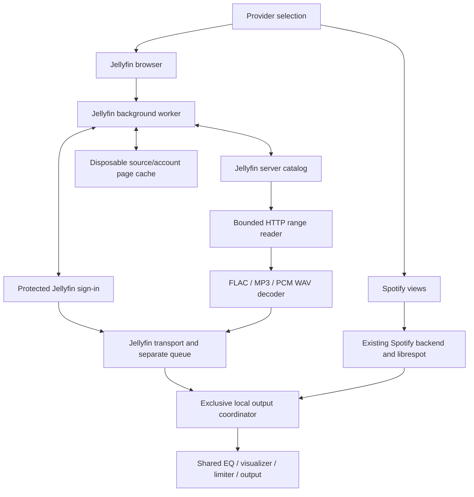

Current priorities and completion status are in [the working roadmap](https://github.com/elav000/spotifast/blob/main/ROADMAP.md).
The milestone notes below are chronological history; older "next step" sections
may already be completed.

# Jellyfin in the elav000 fork

This fork is adding Jellyfin alongside Spotify. Upstream Spotifast remains a
Spotify client; its releases do not include this experimental work.

## Current implementation

The sign-in screen lets you choose Spotify or Jellyfin. For Jellyfin, choose a
saved server or enter a new server address, choose **Connect with Quick Connect**,
and approve the displayed code in a signed-in Jellyfin client. After sign-in, use
**Settings** to switch providers and manage saved Jellyfin servers. Each
server/account can have its own nickname, can be activated or removed, and adding
another server keeps the current connection available until the new approval
completes. The account menu identifies the active Jellyfin server with its mark
and nickname. The provider dropdown has been removed from the main interface. The existing central page frame,
Back/Forward controls, search bar and Library rail serve Jellyfin too. Spotify
keeps its own sign-in, navigation history and search state. The Library rail
offers Albums, Artists and Playlists for Jellyfin; the selected music library
scopes albums, artists and search, while playlists belong to the signed-in
account.

Search supports All, Songs, Artists, Albums and Playlists, with server paging.
Artist pages offer albums and songs. Album, artist, playlist and search-song
playback use the appropriate catalog request and preserve playlist occurrences.
Home keeps the server's music libraries available for selection, then shows
**Recently Added Music**, **Recently Played**, and **Frequently Played** shelves
from the active Jellyfin account across its music libraries. The shelves use
the server's DateCreated, DatePlayed and PlayCount ordering. Recently Played
lists each audio item once because Jellyfin provides per-item play state rather
than a play-occurrence log. The rail's recent-context order remains the existing
local, account-scoped history.

Create public or private playlists with the existing creation dialog. Playlist
cards and pages offer rename and deletion confirmation. Song menus reuse the
playlist picker for adding songs; playlist entry menus remove a specific
occurrence or move it up/down, including across page boundaries. Jellyfin
checks edit permissions. Refused or failed edits remain visible and failed
optimistic row changes restore their previous presentation. These controls do
not edit Spotify playlists.
The existing Audio cache setting now controls both backends through a common
policy. Its size allowance is split equally between the existing librespot store
and the shared HTTP range store. Jellyfin replays and seeks reuse validated ranges
when the server supplies a usable strong entity validator. Each new playback first makes an
authenticated one-byte range request to validate access and the current entity.
A strong ETag is preferred; without an ETag, a valid Last-Modified date at
least 60 seconds older than the response Date is accepted. Other responses
keep using memory read-ahead. These are playback
caches, not offline downloads; cache files can remain after sign-out, while
fresh authorization and account identity are required before reuse.

Your selected provider is remembered. Jellyfin sign-in uses the system credential
store, so the app can restore it after restart. Settings manages the current
Jellyfin connections. Each account nickname and the active account are saved
atomically; older single-account files are migrated when read. Removing an
account removes its cached pages and revokes local restoration even if
protected-store deletion fails. New Jellyfin UI text is currently English.

Jellyfin pages show saved results while refreshing. A server failure leaves the
last results visible with a warning; Refresh retries. These caches are disposable
and source/account scoped. There is no Combined provider yet. Switching providers does
not send a playback command; existing Spotify playback can continue while you
browse Jellyfin. Play an album or individual track to start Jellyfin playback.
The shared player bar provides Play/Pause, Seek, Volume and Next/Previous.
The existing Winamp mini player also stays open with a Jellyfin session or active
Jellyfin playback, without requiring Spotify sign-in. Its main transport controls
use the same playback actions. Its existing playlist pane consumes the shared
queue presentation: current song, manual occurrences and remaining context keep
the same order as the main queue. Double-click starts that occurrence. REM removes
selected manual occurrences atomically or clears the manual queue. ADD opens
Jellyfin search or the music library; MISC and I open the song's album when known.
LIST OPTS loads Jellyfin playlists or saves the queue using the same provider
action as the main view. Browsing another provider does not retarget these actions.
Spotify retains its existing stale-response row handling. Saving its queue while
browsing Jellyfin still creates a Spotify playlist.
Jellyfin retains its own queue controller behind the shared queue page and panel: manually added songs play before the remaining
album, duplicates are preserved, and Clear removes only manually queued songs.
Switching browsing providers leaves playback running.

`src/provider.rs` defines browsing selection. `src/jellyfin/` owns Jellyfin client
and presentation data; its worker is mounted under `backend::jellyfin` for network,
credential and disk work. `src/ui/jellyfin.rs` retains provider sign-in. `src/ui/queue.rs` renders both providers
through the playback-owned presentation adapter in `src/provider/queue.rs`.
Connected browsing uses the existing central page and shared UI modules, with
provider actions applied in `App`, following upstream's UI contract.

Non-secret state files are `jellyfin-account.json`, `browsing-provider.json` and
`jellyfin-revoked` under `AppDirs.state`. Tokens use the separate protected-store
service `rocks.spotifast.Spotifast.jellyfin`, keyed by source and user. Metadata
pages live under `AppDirs.cache/jellyfin/<source-id>/`, with a versioned envelope
that also validates server/user identity. No token is serialized into those files.

Run the connection/browsing diagnostic without a Spotify account:

```sh
cargo run --locked --example jellyfin_browse -- http://your-server:8096/jellyfin
```

The `/jellyfin` suffix is only needed when your reverse proxy uses that path.
Bare hostnames and ports are accepted too. Approve the displayed code in an
already signed-in Jellyfin client. The probe waits up to five minutes, prints
music libraries, the first ten albums and tracks from the first album, then
exits. Ctrl-C cancels it. Quick Connect currently uses POST initiation, matching
the NativeAmp reference implementation; compatibility with older servers needs
live verification.

The diagnostic token stays in process memory and is discarded on exit. The
diagnostic does not save credentials or caches; the app does. Neither has a
password form or downloads. Requests use the system proxy
in this diagnostic; the client API accepts Spotifast's proxy configuration.
Tokens travel in authorization headers. Redirects are rejected, so configure the
final server address directly. Do not log request objects or authorization
responses: Quick Connect polling necessarily includes a temporary secret in its
query. HTTP is supported for private-network servers; use HTTPS where appropriate
for the connection.

`stream_request` only constructs a request; it does not play, seek or decode audio.
No live server credentials are used by the automated local HTTP contract tests.

## Architecture direction

- Separate provider browsing first. Spotify and Jellyfin remain authoritative
  for their own catalogs. A Combined provider remains future work.
- Provider selection before Spotify login, protected source/user-scoped
  credentials and separate cached browsing are implemented.
- Keep selected browsing provider separate from playback ownership. Changing a
  view must not interrupt sound. The shared processing path has exclusive
  local output leases and request tickets so an older load cannot steal output.
- Use stable provider/source/item references. Never persist expiring stream URLs
  as identity or manufacture Spotify URIs for Jellyfin items.
- Add disposable provider/source/user-scoped snapshots for fast startup. Reuse
  atomic writes and cache budgets where useful, but never infer equivalence
  from matching album names or item IDs across providers.
- Original FLAC, WAV and MP3 decoding is proven through the existing
  EQ/output/visualizer classes. The app uses the same path for its separate Jellyfin transport and queue.
- A Combined provider, mixed queues, local-file browsing and downloads remain
  later work, not prerequisites.

## Validation

Focused request tests: `cargo test --locked --lib jellyfin::`.
The probe requires manual Quick Connect approval. Automated tests cover pending
and approved exchanges, music-only filtering, paging and ordering, reverse-proxy
paths, credential headers, range construction, rejected redirects and redacted
errors. Transport tests additionally cover queue priority, duplicates, Previous, cancellation,
seek state and paused session restoration. Deterministic UI tests exercise the
shared controls and queue. Live server and device checks remain manual.

## Keeping the fork current

`origin` is `elav000/spotifast`; `upstream` is `crmne/spotifast`. Keep the
upstream remote and dependency pins intact. The initial implementation adds one
module export to existing Rust code; its client, tests and diagnostic live in
new files. Subsequent UI integration should use a small provider entry point,
not duplicate or mechanically rewrite Spotify pages.

For an upstream update, fetch and review the incoming changes, prepare a separate
integration branch, replay the selected upstream commits with their attribution,
and run the baseline plus Jellyfin tests before advancing the fork's main branch.
Resolve conflicts in that integration branch. Preserve the fork's linear history;
do not use a force-sync operation that discards Jellyfin commits, or rewrite
published history without an explicit decision. Dependency updates should come
from upstream first when possible. Keep the connection/browsing and audio work in
separate commits so failures can be isolated and reverted.

Jellyfin-only use is the primary workflow for this fork. Spotify login is optional.


Deterministic UI fixtures use `--features demo` with `--demo-page jellyfin`,
`jellyfin-connect`, `jellyfin-approval`, `jellyfin-albums`, `jellyfin-tracks`, or
`jellyfin-error`. They contain invented data and never read credentials or contact
a Jellyfin server. Combine with `--demo-shot`, `--demo-size` and `--demo-show light`.
The new native credential round-trip check uses a temporary dummy token and is
opt-in: `cargo test --locked --lib backend::jellyfin::tests::native_store_round_trip -- --ignored --exact`.

## Audio playback

The application's Spotify sinks now join a shared `LocalOutput` coordinator.
Each start acquires a fresh lease. A later owner fades and discards the old
device queue; stale writes are paced and discarded before EQ or visualization.
Delayed stops and drops cannot release a newer lease or clear its visualizer.
The coordinator is retained across audio-settings engine replacements and is
independent of the selected browsing provider. In-app Jellyfin sinks
join this same coordinator through `Tapped::with_output`. The Jellyfin transport
uses a dedicated worker for credentials, album resolution, decoding and output.
Automatic takeover currently requires the normal RodioSink output. Optional
librespot backends must stop on their playback thread before another provider
can acquire output; a claim while one remains active is rejected without
opening the new device. The controller pauses local Spotify playback before starting Jellyfin; a backend
that has not released output produces a playback error rather than overlapping sound.

The app browser exposes playback and queue actions. A separate development probe verifies
original FLAC, MP3 and PCM/WAV through the existing `Tapped` EQ/visualizer/limiter
and `RodioSink` device path. It reads the account saved by the app from protected
storage, without changing that account or provider selection.

```sh
# Silent network/decode/EQ/tap check. Optional library name.
cargo run --locked --example jellyfin_audio_spike -- "My music" --format=flac
# Short low-volume device check, including a seek to 90% of the track.
cargo run --locked --example jellyfin_audio_spike -- "My music" --audible
```

Stop other local audio before the audible diagnostic. It is a standalone probe,
independent of the app coordinator for mutually exclusive provider playback. The probe
uses the system proxy; no manual proxy credentials are read or copied.

By default it selects the first track of the first album. `--format=flac`,
`--format=mp3` or `--format=wav` instead looks for that container in the first 500
tracks of the selected library. The diagnostic decodes about three seconds,
seeks to 90%, then decodes another three seconds. It prints catalog format,
decoded rate/channels, first-PCM and seek latency, range statistics, and whether
the post-EQ visualizer tap received samples. Only `--audible` opens an audio device.

Catalog DTOs now request container and stream metadata, including codec, sample
rate, channels and bit depth. They retain no raw provider URLs or HTTP headers
from `MediaSources`. The decoder probes the bytes rather than trusting the file
name or catalog hint.

The diagnostic reader retains one validated 256 KiB range. App playback uses
1 MiB ranges and fetches the next range in the background while consuming the
current one. Sequential playback retains at most two ranges; a seek can briefly
retain one unrelated speculative range while fetching its new position. It
checks 206/Content-Range, size, total length and supplied entity
validators, rejects redirects and whole-file 200 responses, and leaves its cursor
unchanged when a range fails. Seeking uses the demuxer's index/timestamps and
resets decoder/resampler state; a byte-range offset is never treated as a time.
MP3 uses fast, approximate demuxer seeking: its exact mode scans prior frames over
HTTP and was too slow on a live large MP3. FLAC and WAV use accurate seeking.
PCM enters the existing sink in 10 ms chunks to retain its bounded queue. Mono
is duplicated to stereo, and other input rates are converted to 44.1 kHz before
entering the current DSP. This is not a bit-perfect/high-resolution output claim.

Current limits: mono/stereo 8–192 kHz; the blocking reader can take up to its
20-second request timeout to return after cancellation during an in-flight
request. Transient range failures and temporary server errors receive at most
two automatic retries, with 150 ms and 400 ms backoff. Malformed ranges,
authorization errors and entity changes fail without retry. Each attempt fetches
and validates a complete range before exposing bytes to the decoder. Incremental
delivery from an incomplete range is deferred until timing evidence shows the
server delivers useful bytes before a full range completes. Full process memory
(including demuxer metadata/artwork) has
not been profiled. Jellyfin playback does not yet offer transcoding, downloads, shuffle, repeat,
lyrics or artwork in the shared player bar.

### Current boundaries



Each provider remains authoritative. No Combined provider is added in this milestone.
Shared presentation models and widgets can be extracted incrementally, while
provider-specific references and actions remain explicit.

## Playback restoration and fork updates

`jellyfin-playback.json` stores the current song, album context, manual queue,
previous-song history and position under `AppDirs.state`. It contains catalog
metadata and stable identities, never credentials or stream URLs. Restoration
requires the same saved source and account and always starts paused. Choose
Resume Jellyfin to take playback ownership. Signing out clears the playback
session. The Spotify resume session remains separate.

The updater checks `elav000/spotifast`, so an upstream release cannot silently
replace this fork. Signed fork releases are not configured yet: the inherited
publisher key must be replaced with the fork's own release key and matching
release-workflow secret before publishing updates. Signature verification remains
required. Integrate upstream source changes using the workflow above.

Playback demo pages are `jellyfin-playing` and `jellyfin-queue`, in addition to
the browser fixtures above. They never open an audio device or read sign-in data.

## Shared views and a future mixed queue

Separate catalogs do not require separate presentation or separate playback queues.
The current Jellyfin browser and queue controller establish the first provider
integration. They are not a decision to duplicate the entire Spotify interface.
The left rail, page shell, collection grids, track lists, album/artist layouts,
player bar and queue presentation should be reused through provider-aware view
models. Spotify Home's recommendations and Connect actions remain provider
capabilities; Jellyfin can supply its own Home sections without impersonating
Spotify identities or duplicating its network calls.

The next queue step, before adding mixed playback, is to extract the common local
ordering, priority additions, duplicate occurrence identity, history and persistence
policy. Entries must carry a tagged Spotify reference or Jellyfin source/account/item
reference. Provider adapters resolve metadata and play an entry; an exclusive output
coordinator handles each handoff. Switching browsing providers never changes the
queue. An explicit Play action and Add to queue keep distinct, documented semantics.
Existing Spotify behavior and the separate Jellyfin transport tests are the
regression contract during that extraction.

A mixed local queue can therefore contain both providers while the libraries and
caches remain separate. Spotify Connect's remote queue is a Spotify-only service;
it cannot be treated as storage or playback for Jellyfin entries. A future mixed
queue needs explicit local ownership and remote-device capability handling rather
than submitting foreign entries to Spotify. Unified catalog browsing, mixed local
playback and shared UI extraction are independent decisions. None is implemented
by the current separate queues.

### Roadmap goal after playback verification

Target: the existing Spotify interface powered by the selected provider, including
Jellyfin, rather than a separate Jellyfin interface. Preserve the familiar left
rail, Home layout, collection pages, player and queue; vary data and available
actions through provider capabilities. Jellyfin Home content is intentionally
undecided: use appropriate sections such as those in a traditional Jellyfin
client, while retaining the shared page shell.

Finish the current playback milestone before beginning this work. Reuse existing
UI and infrastructure whenever a provider adapter can power it. Do not build a
parallel sidebar, Home shell, collection view, queue policy or cache mechanism
merely because its data comes from Jellyfin. Keep service-specific capabilities
and requests in adapters; extract existing shared behavior instead of replacing
it with a second implementation. Separate catalogs remain a product constraint.

Acceptance criteria for the later milestone:

1. Map the existing sidebar, Home sections, collection/album/artist pages, track
   rows and queue UI to their data and action dependencies before adding views.
2. Reuse those components with explicit provider references and capabilities;
   retain Spotify's existing behavior and Jellyfin-only operation without login.
3. Extract common local queue ordering, duplicates, history and persistence from
   existing behavior before implementing mixed provider playback. One local queue
   may contain both providers without a unified catalog. Browsing never resets it.
4. Reuse cache storage, budgets and atomic writes where applicable, retaining
   provider/source/account isolation and disposable metadata.
5. Keep provider transport and protocol differences behind adapters, preserve
   upstream updates, and verify both providers' behavior with regression tests
   and representative UI checks. Handle Spotify-only remote Connect explicitly.

This is the recorded next goal, not part of the current playback implementation.

## Shared navigation, album views and artwork

The first step extends the existing `ArtLoader` with provider fetch adapters.
Jellyfin primary-image requests use protected sign-in headers, reject redirects
and preserve reverse-proxy paths. Stable artwork references include provider,
source, account, item and image tag. The existing disk cache, byte limits, scaler,
texture budget and player cover rendering remain shared. Provider images live
under `art/providers/<provider>/<source>/<account>/`; clearing the existing art
cache also clears these nested entries. Image revisions use different cache keys.

Navigation and view dependency map:

| Existing component | Reuse | Provider dependency to adapt |
| --- | --- | --- |
| `ui/sidebar.rs` panel and navigation rows | Keep panel sizing, styling, focus and navigation presentation | Supply provider-specific library entries and actions rather than Spotify grants or playlist roots |
| `ui/widgets.rs` collection cards | Keep artwork, captions, hover and focus behavior | Supply stable artwork references and provider navigation/play actions |
| `ui/collection.rs` hero and actions | Keep album presentation and shared controls | Supply provider metadata and capabilities; disable unavailable service actions |
| `ui/widgets.rs` track rows and collection table | Reuse presentation and interaction semantics | Separate row metadata/occurrences from Spotify-specific menus, links and requests |
| Shared player bar | Already used by both transports; now accepts Jellyfin artwork references | Keep provider identity explicit; no fake Spotify IDs |
| Home sections | Reuse the page shell after the initial navigation/album work | Decide appropriate Jellyfin content separately |
| Queue and artist pages | Later extraction from existing behavior | Shared local queue policy and provider-aware navigation before mixed playback |

Jellyfin now uses the existing sidebar panel and navigation rows, collection
cards, album hero and track-row renderer. Provider references and actions retain
Jellyfin identity without inventing Spotify IDs. Spotify-only row actions are
replaced with available Play and Add to queue actions. Provider switching lives in the shared left rail and remains available on either
sign-in screen. At this milestone, a collection selector under Library chose the Jellyfin music library; Home
currently opens the Jellyfin library list. Home sections,
artist pages and a shared local queue remain follow-up work, not completed parity.

Artwork requests share the existing 8 MiB response limit and request images up to
640 pixels wide. Cache hits need no new server request. Fresh browsing metadata
can update the current track's artwork without resetting playback, position or
queue. Cache clearing runs on the background worker, including while offline.
This work adds no dependencies and does not merge catalogs.


### Left rail provider switching (earlier milestone)

At this milestone, the shared sidebar contained a Music source selector for Jellyfin and Spotify.
It changes the browsing provider without changing playback or combining catalogs.
Jellyfin's collection selector chooses the server music library; Spotify keeps
its existing library controls after sign-in. The temporary top provider bar has
been removed. The rail is available while signed out of either service, and its
existing visibility shortcut and a Show sidebar button restore it when hidden.
This does not implement a Combined provider, a new Home feed or a shared queue.


## Full provider-fed left rail (earlier milestone)

The simplified Jellyfin navigation branch is replaced with provider-supplied
Library data and actions feeding the existing sidebar toolbar, shelf chips,
search field, sort menu, virtual list, grid renderer, artwork previews and local
pin handling. At that milestone Jellyfin supplied Albums, library order, Name and
Recently played. Spotify retains its existing shelves and service capabilities.
Only supported actions appear; Jellyfin entries never acquire Spotify IDs or
Spotify drag/drop payloads. At that stage a collection dropdown selected the Jellyfin music
library. It has since moved into the account menu, described below.

Rail albums and the center page have independent view state. Album pages load in
batches on the existing worker using the existing account-scoped metadata cache;
each next batch returns to the command queue so foreground browsing can run
between batches. Catalog requests have their own revision and validate source
and account, so center navigation cannot erase the rail and replies for an old
collection/account cannot populate the current one. Loading and retry use shared
widgets. Opening a rail album uses provider actions; cover Play waits for its
track response. Browsing and source switching leave playback ownership alone.
Recently played reuses the persisted local context history with provider/source/
account keys. It does not import older Jellyfin server listening history.

### Provider terminology and roadmap recorded at that milestone

A **Combined provider** is the planned composition of providers such as Jellyfin
and Spotify, potentially Plex later. It will retain each item's origin while
feeding the same UI contract. It is not implemented in this milestone. Separate
provider browsing does not justify separate panels or duplicated local policy.

Remaining architectural work is explicit:

- Broaden the provider data/action contract across the remaining app routes;
  Spotify's existing data shaping still supplies its side of the shared rail.
- Replace Jellyfin's separate center-page controller with provider data feeding
  the existing page controllers. Cards, album hero and track-row renderer are
  already shared; the entire page controller is not yet shared.
- Let the track renderer consume neutral metadata directly, replacing the current
  adapter through Spotify-shaped display structs (which contain no fake IDs).
- Extract the existing local queue presentation, ordering, history and persistence
  before adding mixed playback. At that milestone Jellyfin's queue panel/controller remained
  separate; Spotify Connect requires explicit provider capability handling.
- Provider-appropriate Home sections and artist/playlist support remain later
  capabilities. No new bespoke panels should be introduced to implement them.

The shared artwork cache, player bar, DSP and exclusive output ownership already
carry forward. Plex support and a Combined provider are roadmap items, not claims
of current compatibility.

### Adapter completion criteria

The shared rail milestone is a foundation, not a complete Jellyfin adapter.
Remaining work must implement Jellyfin-backed search, artist browsing, playlists
and listening-history support through the existing UI and provider contracts.
An unimplemented adapter operation is a tracked gap, not evidence that Jellyfin
lacks the capability. Hide or explain an action as unavailable only after checking
what the service actually supports. Spotify-specific features with no equivalent
remain explicit capability differences.

The implementation order is Search, Artists, Playlists (including applicable
management actions), then server listening-history integration with local history.
Each step must connect the existing controls and pages, carry source/account/item
identity through navigation and playback, preserve other providers' behavior,
and include focused tests and representative live verification. Extend shared
contracts where needed; do not add another provider-specific panel. A future
Combined provider and additional adapters such as Plex must compose those same
contracts rather than introduce another set of views.


## Catalog adapter request foundation

The Jellyfin client now exposes account-scoped, paged queries for artists,
playlists, artist albums and songs, typed search results, and server listening
history. Artist songs stay within the selected music collection. Playlists
are user-scoped rather than children of a music collection, and their entries
retain server order and occurrence IDs, including repeated songs.

Client operations also cover private playlist creation, rename, deletion,
adding songs, removing specific occurrences, and moving an occurrence. Rename
sends only the name, preserving entries and sharing. Batched operations validate
all IDs before sending and stop on the first failed batch. A failed later batch
may leave earlier successful batches applied; callers must refresh the server
state rather than assume an atomic edit. Playback start, progress and stop
requests use signed 64-bit Jellyfin ticks and keep credentials in headers.

At commit c2b9ba4 these were client contracts only. The connected wiring
described below builds on that foundation. All request tests use a local fixture
server and never edit the user's Jellyfin playlists.


## Connected adapter wiring

The catalog contracts above are now consumed by the app worker, shared rail,
central page, top bar, Search, catalog cards, collection hero, track rows and
playlist dialogs/picker. The previous Jellyfin-only connected central panel
has been removed. Spotify album/artist library cards and Jellyfin catalog
cards use the same card action renderer; both providers use the same playlist
picker filtering, keyboard navigation and row selection.

Jellyfin playback reports start, pause/resume changes, periodic progress (every
ten seconds) and stop to the server, independently of browsing selection.
Loading or a paused restored session does not create a new playing session.
A reporting failure is shown without stopping audio. Reports run on the existing
Jellyfin worker and keep credentials in headers. These requests update the
user's Jellyfin listening history; no other reporting service is added.

Playlist queries and optional playback queries are saved with the current
playback context. Older album sessions remain readable. A repeated song starts
at its chosen occurrence rather than the first matching song ID. Catalog and
edit replies reject replaced accounts; an edit result cannot navigate over a
newer page choice. The current separate Jellyfin queue remains as documented;
Combined-provider browsing and a mixed queue are future work.


### Menu placement

Source selection lives in the existing account menu. Jellyfin's music-library
choice is under its Jellyfin submenu. Sign-in screens offer a source menu so
neither provider requires signing into the other first. The left rail has no
added source or collection controls; its existing Home, Search, shelf pills,
filter, sort, grid/list and playlist creation controls receive provider data.
The sort label remains upstream's current label, with clearer wording recorded
as later polish.


### Playback underrun correction

Live listening exposed repeated output underruns when each 256 KiB network read
ran synchronously after the preceding range was exhausted. Playback now uses the
buffered reader above, keeping network waits ahead of the current sound rather
than on each output refill. It still validates ranges and entity identity,
rejects redirects, preserves exact seeking, and cancels replaced playback.
Tests cover advance fetching without consumption, reuse without duplicate reads,
seeks past stale prefetched data, changed-entity rejection, retry and cancellation.
This adds no persistent audio cache, dependency or setting.


### Streaming reuse boundary

The current librespot dependency already supplies Spotify read-ahead, downloaded
range tracking and optional disk audio caching. Its AudioFile entry point requires
a Spotify Session and FileId and resolves Spotify CDN storage internally. It is
not a generic authenticated HTTP media source. Its disk cache also uses FileId;
Jellyfin must not acquire invented Spotify identifiers to fit those APIs.

The app already shares the output sink, bounded output queue, DSP and device
ownership. The remaining roadmap is a neutral seekable encoded-audio source and
cache contract: providers resolve identity, authorization and transport, while
reusable infrastructure owns buffering, cache accounting and eviction where the
backend exposes those hooks. Audit existing librespot interfaces or a suitable
upstream extraction before adding more streaming/cache policy. Spotify's existing
backend can remain behind that adapter. Jellyfin and future Plex support should
reuse the neutral HTTP implementation, rather than duplicate a downloader per
service. That read-ahead milestone used bounded memory only. The shared foundation below
now adds persistent HTTP caching; a single streaming engine remains future work.


### Playback verification and remaining buffering case

NativeAmp's Swift path was reviewed: it parses response data incrementally on
its URLSession delegate queue and bounds queued PCM to eight seconds. The current
Rust correction is input read-ahead, not that full PCM scheduling design.
A paced 30-second live WAV decoder probe passed without any read taking more
than 150 ms. The app subsequently played for several minutes with the user
confirming continuous sound and no further underruns. One 38-second startup
underrun occurred during concurrent diagnostics; its cause is not established,
and cold-start/jitter buffering remains a follow-up. Do not claim that every
network stall is resolved or that the full streaming layer is shared.

Playback failures are now rendered through the shared error row on connected
provider pages as well as recorded with a redacted message in the app log. This
restores visibility lost when the old connected Jellyfin panel was removed.


## Shared encoded-audio and cache foundation

`src/media/http.rs` and `src/media/decode.rs` now own the provider-neutral HTTP
range reader and WAV/FLAC/MP3 decoder. The Jellyfin adapter supplies its request
and stable provider/source/server/account/item identity. Its former module paths
remain compatibility exports for diagnostics. There is one HTTP implementation
to reuse for future providers such as Plex. The tests use generic authenticated
HTTP requests without constructing a Jellyfin client.

`src/media/cache.rs` supplies the common cache policy consumed by both
`EngineConfig::open_cache` (librespot) and the HTTP adapter. No dependency fork or
invented Spotify file identifiers are introduced. Spotify retains its native
fetching/decoding/cache internals. A single shared downloader, PCM queue and
cross-provider LRU are not claimed. Each backend gets half the existing Audio
cache limit, enforced when that backend opens or writes its cache. A previously
larger inactive cache shrinks when its backend next applies the policy. Unused
allowance is not borrowed between backends in this version.

Spotify's existing `AppDirs.cache/audio` path is preserved. HTTP ranges use its
sibling `audio.streams`, outside librespot's recursively managed directory.
Both paths appear in the existing Storage row. Disabling Audio cache prevents
new HTTP cache reads/writes after applying playback settings. It leaves existing
files in place, matching the retained-cache behavior of the native engine.

The HTTP cache stores only complete, checked ranges, published atomically on
media workers. Keys hash the stable identity, current entity validator, length and
aligned byte range; no URL, header, token, or raw identity is persisted. A
versioned length/checksum envelope rejects truncated or corrupt files. Touches
and eviction apply only to owned cache files; failed disk reads/writes fall back
to streaming. Memory read-ahead remains bounded and seek/cancellation checks
remain in force. There is no background whole-library audio download: only
played/searched byte positions and the one-range read-ahead enter the cache.

A repeated playback still validates authorization online. A changed entity or
account cannot reuse old bytes, and a 401 fails before disk cache access. Weak tags, missing dates and recent/ambiguous dates disable disk reuse.
Responses marked no-store also bypass disk caching. The earlier cold-start/jitter issue is
still a tracked verification case; extraction and disk caching do not by
themselves guarantee uninterrupted playback through arbitrary network stalls.


Date fallback follows [RFC 9110, section 8.8.2.2](https://www.rfc-editor.org/rfc/rfc9110.html#section-8.8.2.2),
using a conservative 60-second separation. An ETag, including a weak ETag,
prevents falling back to a date validator. Initial authorization probes request
revalidation with Cache-Control: no-cache. The cache identity also includes the
encoded representation, so a future provider must distinguish original audio
from each transcoding profile. The user's live server supplies the date headers
needed for this fallback; it does not supply an ETag on original-audio responses.


### WAV underrun after the shared-cache milestone

The installed 6030024 build stalled on a WAV track and later resumed. The log
records a 28,486 ms gap between output packets. A subsequent uncached 4 MiB
read of that file completed in about 4.5 seconds, with individual range reads
between 0.55 and 1.48 seconds. This does not identify the cause of the earlier
delay or prove it fixed. A sample taken after recovery showed the playback
worker pacing its output and the read-ahead worker reading an HTTP response.

Redacted timing diagnostics now distinguish slow response headers/body reads
from slow persistent-cache writes. They record byte offsets, sizes and elapsed
times only, without URLs, identities or authorization values. The installed
diagnostic build retains the existing transport behavior. A whole-range wait
and only one range of read-ahead remain buffering limitations. Further work
should address incremental delivery and report buffering through shared player
state while preserving responsive controls. Do not attribute this event solely
to the server, network, cache, or decoding without timing evidence.


### Buffering resilience and whole-response deadlines

The timing build subsequently captured response bodies taking 17,245 ms and
62,048 ms, despite headers arriving in 69 ms and 65 ms. These correlated with
11,372 ms and 50,443 ms output underruns. Slow audio-body delivery is established;
the reason for that server/network delay is not. No similarly slow cache write
was recorded for these events.

The blocking HTTP client timeout had restarted for each read, allowing a
trickling body to outlive the intended 20-second range limit. Each audio request
now carries its own timeout, which reaches reqwest's asynchronous whole-response
deadline. A regression fixture trickles a response within each individual read
interval but beyond the whole-request budget, and verifies that partial ranges
never advance the cursor or enter the cache. After bounded automatic retries are
exhausted, failure remains visible; Play can retry from the retained position.

The provider-neutral media pipeline now decodes on its own worker, with at most
eight seconds of queued stereo 44.1 kHz PCM plus one bounded codec block being
split into short chunks. Playback starts or resumes from an underrun with a
one-second cushion (or a shorter final tail). Input waits no longer own the
transport loop: pause, skip and seek intent remain responsive, and seek revisions
discard old queued and in-flight PCM. Natural EOF and errors do not cancel the
enclosing track, so existing queue advancement/error handling remains active.

An exhausted buffer uses the existing shared player spinner. The same control
remains an accessible Pause button while buffering; pausing restores Play. No
provider panel, setting or mixed queue is introduced. This pipeline is reusable
by other HTTP providers; Spotify retains its native decoder/queue. A finite
buffer cannot hide arbitrarily long server stalls. Incremental delivery of a
partly received range is deferred until timing evidence shows earlier bytes are
available to consume.


## Shared queue interface

The bespoke Jellyfin right-hand panel has been deleted. Both providers use the
existing queue panel/page, Queue/Recent chips, persisted width and responsive
layout, headings, artwork rows, Clear, Save as a playlist and close control.
Provider metadata and explicit actions feed the same track-row renderer already
used by the shared browsing views. Playback ownership selects the queue; changing
the browsing provider does not substitute another source's queue.

For Jellyfin, manually added occurrences appear under Playing next, followed by
the current context under Next up. Clear removes only manual rows. Shared row
menus support removing one manual occurrence or moving it up/down. Snapshot
identity and source/account checks reject edits from stale menus. Selecting a
queue row retains the existing transport behavior. Add-to-queue actions carry
playback metadata, so they work after browsing away from the original page.

The Save button creates a private Jellyfin playlist from the current and upcoming
queue, deduplicated in playback order, matching the existing Spotify save policy.
It uses an explicit Jellyfin source action even while Spotify browsing is open.
Queue/history rows use account-qualified artwork references and never issue
Spotify metadata, playlist or recent-play requests for Jellyfin items.

Recent currently shows the Jellyfin transport's bounded playback history for its
current context, including repeated occurrences. It does not fetch the complete
server history. Spotify retains its existing merged local/server recent history
and loading behavior. Jellyfin drag insertion/reordering remains disabled until
a provider-neutral drag payload and the shared queue controller are implemented;
manual-row menu edits work now. Spotify drag-and-drop behavior is unchanged.

This is shared interface and presentation infrastructure. Playback queue
controllers and catalogs remain separate; cross-provider playback ordering and
Combined provider composition are later milestones. No Settings fields,
dependency sources or saved-state schemas changed.
