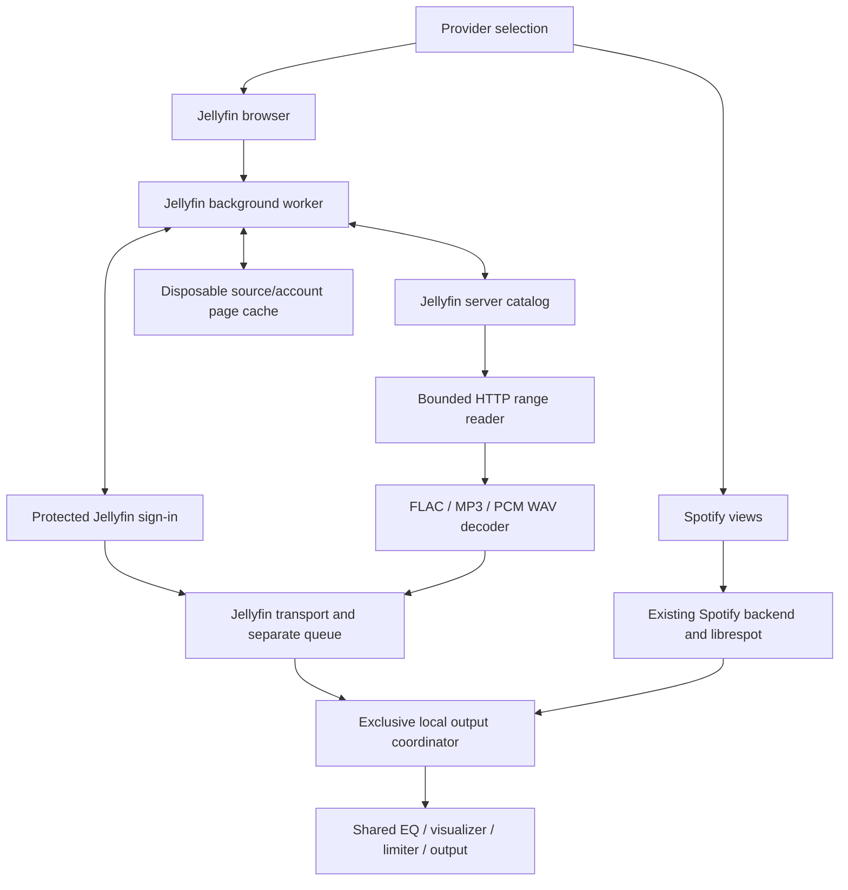

# Jellyfin in the elav000 fork

This fork is adding Jellyfin alongside Spotify. Upstream Spotifast remains a
Spotify client; its releases do not include this experimental work.

## Current implementation

The app opens to Jellyfin by default. The provider selector is available before
Spotify sign-in. Enter your server address, choose **Connect with Quick Connect**,
and approve the displayed code in a signed-in Jellyfin client. Browse music
libraries, albums and ordered album tracks, with page navigation and a filter for
the current page. Spotify keeps its existing sign-in and browsing flow.

Your selected provider is remembered. Jellyfin sign-in uses the system credential
store, so the app can restore it after restart. Sign out removes the account's
cached pages and revokes local restoration even if protected-store deletion fails.
The first version supports one saved Jellyfin account. New Jellyfin UI text is
currently English.

Jellyfin pages show saved results while refreshing. A server failure leaves the
last results visible with a warning; Refresh retries. These caches are disposable
and source/account scoped. There is no unified library. Switching providers does
not send a playback command; existing Spotify playback can continue while you
browse Jellyfin. Play an album or individual track to start Jellyfin playback.
The shared player bar provides Play/Pause, Seek, Volume and Next/Previous.
Jellyfin has a separate queue: manually added songs play before the remaining
album, duplicates are preserved, and Clear removes only manually queued songs.
Switching browsing providers leaves playback running.

`src/provider.rs` defines browsing selection. `src/jellyfin/` owns Jellyfin client
and presentation data; its worker is mounted under `backend::jellyfin` for network,
credential and disk work. `src/ui/jellyfin.rs` draws the separate browser and emits
actions applied in `App`, following upstream's UI contract.

Non-secret state files are `jellyfin-account.json`, `browsing-provider.json` and
`jellyfin-revoked` under `AppDirs.state`. Tokens use the separate protected-store
service `rocks.spotifast.Spotifast.jellyfin`, keyed by source and user. Metadata
pages live under `AppDirs.cache/jellyfin/<source-id>/`, with a versioned envelope
that also validates server/user identity. No token is serialized into those files.

Run the connection/browsing diagnostic without a Spotify account:

```sh
cargo run --locked --example jellyfin_browse -- http://your-server:8096/jellyfin
```

The `/jellyfin` suffix is only needed when your reverse proxy uses that path.
Bare hostnames and ports are accepted too. Approve the displayed code in an
already signed-in Jellyfin client. The probe waits up to five minutes, prints
music libraries, the first ten albums and tracks from the first album, then
exits. Ctrl-C cancels it. Quick Connect currently uses POST initiation, matching
the NativeAmp reference implementation; compatibility with older servers needs
live verification.

The diagnostic token stays in process memory and is discarded on exit. The
diagnostic does not save credentials or caches; the app does. Neither has a
password form or downloads. Requests use the system proxy
in this diagnostic; the client API accepts Spotifast's proxy configuration.
Tokens travel in authorization headers. Redirects are rejected, so configure the
final server address directly. Do not log request objects or authorization
responses: Quick Connect polling necessarily includes a temporary secret in its
query. HTTP is supported for private-network servers; use HTTPS where appropriate
for the connection.

`stream_request` only constructs a request; it does not play, seek or decode audio.
No live server credentials are used by the automated local HTTP contract tests.

## Architecture direction

- Separate provider browsing first. Spotify and Jellyfin remain authoritative
  for their own catalogs. There is no unified library or canonical catalog.
- Provider selection before Spotify login, protected source/user-scoped
  credentials and separate cached browsing are implemented.
- Keep selected browsing provider separate from playback ownership. Changing a
  view must not interrupt sound. The shared processing path has exclusive
  local output leases and request tickets so an older load cannot steal output.
- Use stable provider/source/item references. Never persist expiring stream URLs
  as identity or manufacture Spotify URIs for Jellyfin items.
- Add disposable provider/source/user-scoped snapshots for fast startup. Reuse
  atomic writes and cache budgets where useful, but never infer equivalence
  from matching album names or item IDs across providers.
- Original FLAC, WAV and MP3 decoding is proven through the existing
  EQ/output/visualizer classes. The app uses the same path for its separate Jellyfin transport and queue.
- Unified browsing, mixed queues, local-file browsing, downloads and a possible
  unified library are later decisions, not prerequisites.

## Validation

Focused request tests: `cargo test --locked --lib jellyfin::`.
The probe requires manual Quick Connect approval. Automated tests cover pending
and approved exchanges, music-only filtering, paging and ordering, reverse-proxy
paths, credential headers, range construction, rejected redirects and redacted
errors. Transport tests additionally cover queue priority, duplicates, Previous, cancellation,
seek state and paused session restoration. Deterministic UI tests exercise the
shared controls and queue. Live server and device checks remain manual.

## Keeping the fork current

`origin` is `elav000/spotifast`; `upstream` is `crmne/spotifast`. Keep the
upstream remote and dependency pins intact. The initial implementation adds one
module export to existing Rust code; its client, tests and diagnostic live in
new files. Subsequent UI integration should use a small provider entry point,
not duplicate or mechanically rewrite Spotify pages.

For an upstream update, fetch and review the incoming changes, prepare a separate
integration branch, replay the selected upstream commits with their attribution,
and run the baseline plus Jellyfin tests before advancing the fork's main branch.
Resolve conflicts in that integration branch. Preserve the fork's linear history;
do not use a force-sync operation that discards Jellyfin commits, or rewrite
published history without an explicit decision. Dependency updates should come
from upstream first when possible. Keep the connection/browsing and audio work in
separate commits so failures can be isolated and reverted.

Jellyfin-only use is the primary workflow for this fork. Spotify login is optional.


Deterministic UI fixtures use `--features demo` with `--demo-page jellyfin`,
`jellyfin-connect`, `jellyfin-approval`, `jellyfin-albums`, `jellyfin-tracks`, or
`jellyfin-error`. They contain invented data and never read credentials or contact
a Jellyfin server. Combine with `--demo-shot`, `--demo-size` and `--demo-show light`.
The new native credential round-trip check uses a temporary dummy token and is
opt-in: `cargo test --locked --lib backend::jellyfin::tests::native_store_round_trip -- --ignored --exact`.

## Audio playback

The application's Spotify sinks now join a shared `LocalOutput` coordinator.
Each start acquires a fresh lease. A later owner fades and discards the old
device queue; stale writes are paced and discarded before EQ or visualization.
Delayed stops and drops cannot release a newer lease or clear its visualizer.
The coordinator is retained across audio-settings engine replacements and is
independent of the selected browsing provider. In-app Jellyfin sinks
join this same coordinator through `Tapped::with_output`. The Jellyfin transport
uses a dedicated worker for credentials, album resolution, decoding and output.
Automatic takeover currently requires the normal RodioSink output. Optional
librespot backends must stop on their playback thread before another provider
can acquire output; a claim while one remains active is rejected without
opening the new device. The controller pauses local Spotify playback before starting Jellyfin; a backend
that has not released output produces a playback error rather than overlapping sound.

The app browser exposes playback and queue actions. A separate development probe verifies
original FLAC, MP3 and PCM/WAV through the existing `Tapped` EQ/visualizer/limiter
and `RodioSink` device path. It reads the account saved by the app from protected
storage, without changing that account or provider selection.

```sh
# Silent network/decode/EQ/tap check. Optional library name.
cargo run --locked --example jellyfin_audio_spike -- "My music" --format=flac
# Short low-volume device check, including a seek to 90% of the track.
cargo run --locked --example jellyfin_audio_spike -- "My music" --audible
```

Stop other local audio before the audible diagnostic. It is a standalone probe,
independent of the app coordinator for mutually exclusive provider playback. The probe
uses the system proxy; no manual proxy credentials are read or copied.

By default it selects the first track of the first album. `--format=flac`,
`--format=mp3` or `--format=wav` instead looks for that container in the first 500
tracks of the selected library. The diagnostic decodes about three seconds,
seeks to 90%, then decodes another three seconds. It prints catalog format,
decoded rate/channels, first-PCM and seek latency, range statistics, and whether
the post-EQ visualizer tap received samples. Only `--audible` opens an audio device.

Catalog DTOs now request container and stream metadata, including codec, sample
rate, channels and bit depth. They retain no raw provider URLs or HTTP headers
from `MediaSources`. The decoder probes the bytes rather than trusting the file
name or catalog hint.

The reader retains one validated 256 KiB range and stages at most one replacement
range. It checks 206/Content-Range, size, total length and supplied entity
validators, rejects redirects and whole-file 200 responses, and leaves its cursor
unchanged when a range fails. Seeking uses the demuxer's index/timestamps and
resets decoder/resampler state; a byte-range offset is never treated as a time.
MP3 uses fast, approximate demuxer seeking: its exact mode scans prior frames over
HTTP and was too slow on a live large MP3. FLAC and WAV use accurate seeking.
PCM enters the existing sink in 10 ms chunks to retain its bounded queue. Mono
is duplicated to stereo, and other input rates are converted to 44.1 kHz before
entering the current DSP. This is not a bit-perfect/high-resolution output claim.

Current limits: mono/stereo 8–192 kHz; the blocking reader can take up to its
20-second request timeout to return after cancellation during an in-flight
request. Retrying a failed range is tested; seamless decoder-level stall recovery
is not implemented. Full process memory (including demuxer metadata/artwork) has
not been profiled. Jellyfin playback does not yet offer transcoding, downloads, shuffle, repeat,
lyrics or artwork in the shared player bar.

### Current boundaries



Each provider remains authoritative. No canonical or unified library is added.
Shared presentation models and widgets can be extracted incrementally, while
provider-specific references and actions remain explicit.

## Playback restoration and fork updates

`jellyfin-playback.json` stores the current song, album context, manual queue,
previous-song history and position under `AppDirs.state`. It contains catalog
metadata and stable identities, never credentials or stream URLs. Restoration
requires the same saved source and account and always starts paused. Choose
Resume Jellyfin to take playback ownership. Signing out clears the playback
session. The Spotify resume session remains separate.

The updater checks `elav000/spotifast`, so an upstream release cannot silently
replace this fork. Signed fork releases are not configured yet: the inherited
publisher key must be replaced with the fork's own release key and matching
release-workflow secret before publishing updates. Signature verification remains
required. Integrate upstream source changes using the workflow above.

Playback demo pages are `jellyfin-playing` and `jellyfin-queue`, in addition to
the browser fixtures above. They never open an audio device or read sign-in data.
